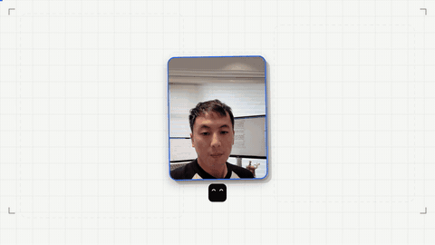

# OpenSay

OpenSay 是一个口播视频模板库：把一段真人口播的音频或视频交给你的 agent，它会照着模板规范逐镜编排画面，渲染出成片。即使是能力一般的模型，按规范也能做出成片。

## 云端曲库 `bgm/`

`bgm/index.json` 列出了每首曲目的时长、大小、sha256 和下载地址。做片时，agent 会按文案情绪和片长挑选曲目，只下载用到的那一首，并用 sha256 核对文件。用户自己提供的音乐优先使用。

## 模板包 `template/`

| 模板 | 文件 | 说明 |
|---|---|---|
| 开放表达 | [`template/开放表达.opensay`](template/开放表达.opensay) | 横屏 16:9；35 个模块；支持真人出镜口播，也能只用口播音频做不出镜的片子 |

### 怎么用

1. 下载 `.opensay` 文件，不用解压。
2. 把它和你的口播视频（或口播音频）一起交给你的 agent（Claude Code、Codex、WorkBuddy 等能执行命令的都行），说一句"用这个模板把我的口播做成视频"。
3. agent 会按文件开头的说明自己解包、检查环境（缺什么会先问你要不要装）、逐镜编排并渲染出片。

需要的环境：Python 3.10+、Node.js 22+、ffmpeg、whisper.cpp（`whisper-cli` 加 `ggml-large-v3-turbo` 模型）。第一次渲染时会自动下载浏览器内核。

### 开放表达 · 部分模块预览

| | | |
|---|---|---|
|  问题卡 |  因果链 |  柱状对比 |
|  真人换位 |  物件卡加 logo |  浏览器演示 |

## skills/

给 agent 用的技能（复制到你的 agent 技能目录即可，例如 Claude Code 的 `~/.claude/skills/`、Codex 的 `~/.codex/skills/`）：

| 技能 | 用途 |
|---|---|
| [`opensay-template-builder`](skills/opensay-template-builder/) | 从一条参考视频新建 OpenSay 模板，或给已有模板补同风格的模块；包含开发规范、准入检查与测试脚本 |
| [`sticker`](skills/sticker/) | 用一条真人口播音频或视频，按 OpenSay 模板做出成片：对齐、分镜、渲染、配乐、审核。不写文案 |
| [`short-release`](skills/short-release/) | 把确认好的成片做成发布包；标题、简介、标签由用户在对话里直接给出，原样使用。含 X 草稿投递契约 |
| [`video-publisher`](skills/video-publisher/) | 把发布包存进小红书、抖音、B站、视频号草稿箱并重开核对；YouTube 走官方 API 私密上传。不公开发布 |
