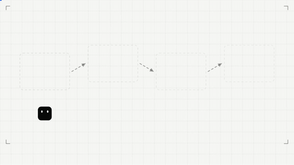
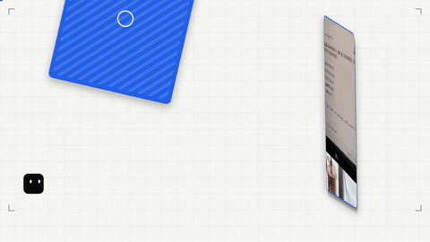
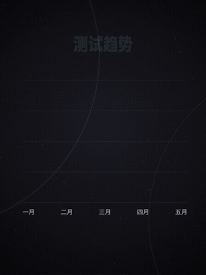
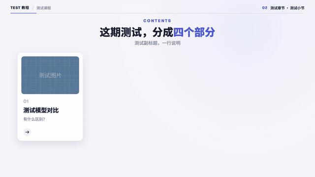
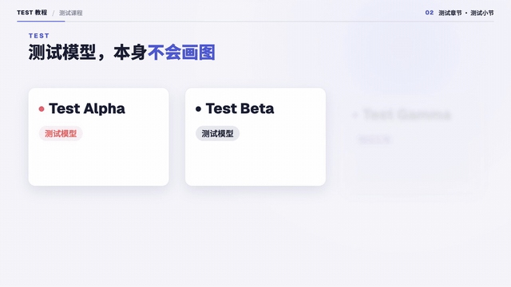
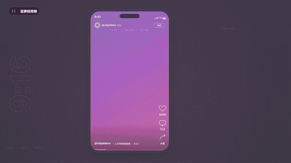
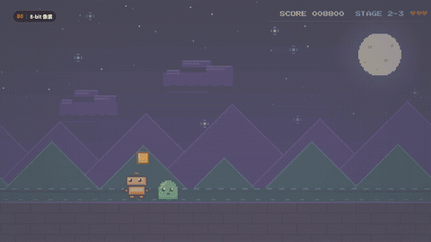
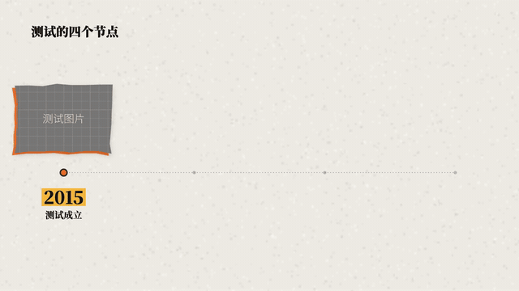
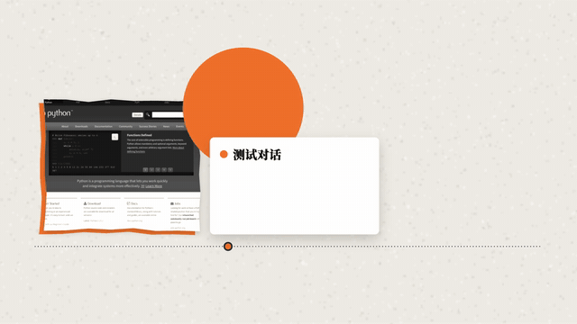

# OpenSay

OpenSay 是一个口播视频模板库：把一段真人口播的音频或视频交给你的 agent，它会照着模板规范逐镜编排画面，检查素材、时序和参数，再渲染出成片。

## 云端曲库 `bgm/`

`bgm/index.json` 列出了每首曲目的时长、大小、sha256 和下载地址。做片时，agent 会按文案情绪和片长挑选曲目，只下载用到的那一首，并用 sha256 核对文件。用户自己提供的音乐优先使用。

## 模板包 `template/`

七套模板共 194 个正式片段，已完成当前版本的技术检查与画面、声音审核。开放表达的 27 个未验证归档片段不在发布范围内。

| 模板 | 文件 | 画幅 | 片段 | 真人出镜 | 录屏 | 说明 |
|---|---|---|---|---|---|---|
| 开放表达 | [`template/开放表达.opensay`](template/开放表达.opensay) | 横屏 16:9 | 46 | 36 | 6 | 纸卡、小人物和红章；大部分片段都能带真人出镜，也能只用口播音频 |
| 印刷海报 | [`template/印刷海报.opensay`](template/印刷海报.opensay) | 竖屏 3:4 | 31 | 4 | 4 | 复古印刷海报风，胶带标签、红章、手写橙字、抖动描边和涂鸦角色 |
| 科技面板 | [`template/科技面板.opensay`](template/科技面板.opensay) | 竖屏 3:4 | 27 | 4 | 4 | 深色科技面板风，薄荷绿数据、玻璃面板和两个自绘角色 |
| 白卡教程 | [`template/白卡教程.opensay`](template/白卡教程.opensay) | 横屏 16:9 | 20 | 3 | 5 | 浅色教程页，页眉细线、白卡片、白边圆角画框、对焦式入场 |
| 暖灰讲解 | [`template/暖灰讲解.opensay`](template/暖灰讲解.opensay) | 横屏 16:9 | 20 | 3 | 5 | 暖灰纸底、炭黑卡、朱红强调、等宽小字和评语胶囊 |
| 黑底大字 | [`template/黑底大字.opensay`](template/黑底大字.opensay) | 横屏 16:9 | 27 | 3 | 5 | 新增手机镜头、3D物件、像素、白板、霓虹轨迹等片段，与终端、大字、录屏结合 |
| 拼贴纪事 | [`template/拼贴纪事.opensay`](template/拼贴纪事.opensay) | 横屏 16:9 | 23 | 3 | 5 | 黑白剪贴画、衬线大字、黄色年份块和时间线，适合讲人物、公司和事件的来龙去脉 |

「真人出镜」是能放真人口播画面的片段数，「录屏」是能播放录屏视频、讲解和录屏动作对上的片段数（两者有重叠）。

「录屏」统计声明了视频 `screen` 槽位的片段。各模板包括讲解跟随、步骤清单、长过程快进和双段对比或真人带讲等不同组合；具体支持范围读包内模块合同。讲到某一步时，由真实词级时间和录屏动作时刻决定进度；素材或时序不满足合同会报错。

模板覆盖开场提问、类比解释、对比、清单、数据、时间线、引用原话、展示照片和录屏、结尾号召等常见分镜。某一镜没有合适模块时，agent 可选择满足素材、参数、事件和时序要求的近似模块，并在项目目录留下 `module-gaps.json`（不含口播原文）；技术检查通过后才能导出。你愿意的话可以把缺口文件发给模板作者，帮助补全模块。

### 怎么用

1. 下载 `.opensay` 文件，不用解压。
2. 把它和你的口播视频（或口播音频）一起交给你的 agent（Claude Code、Codex、WorkBuddy 等能执行命令的都行），说一句"用这个模板把我的口播做成视频"。
3. agent 会按文件开头的说明自己解包、检查环境（缺什么会先问你要不要装）、逐镜编排并渲染出片。

需要的环境：Python 3.10+、Node.js 22+、ffmpeg、whisper.cpp（`whisper-cli` 加 `ggml-large-v3-turbo` 模型），以及可被 Node 加载的 `playwright` 或 `playwright-core` 和 Google Chrome 或已安装的 Playwright Chromium。agent 会先检查环境、说明缺项，征得同意后安装。

### 实时制作工作台

解包后，agent 对本次真人口播运行 `start`，取得项目目录，然后启动工作台并把 URL 告诉你：

```sh
node opensay/.opensay/workbench/server.mjs --project <本次项目目录>
```

用 Google Chrome 打开该 URL，可以看已编译镜头、错误位置和逐字稿，播放预览并编辑镜头。实时预览与部分编译用于制作；完整成片审核要先导出当前版 MP4，实际看完后由你点击确认。发布材料也需在页面展示并确认，agent 按既有授权继续做发布包。

### 开放表达 · 部分片段预览

| | | |
|---|---|---|
| <br>问题卡 | <br>因果链 | <br>柱状对比 |
| <br>真人换位 | <br>物件卡加 logo | <br>浏览器演示 |

### 印刷海报 · 部分片段预览

| | | |
|---|---|---|
| <br>复古显示器 | <br>涂鸦角色阵 | <br>对错清单 |

### 科技面板 · 部分片段预览

| | | |
|---|---|---|
| <br>AB 对照 | <br>数据图表 | <br>结尾号召 |

### 白卡教程 · 部分片段预览

| | | |
|---|---|---|
| <br>目录卡 | <br>选项卡对比 | <br>录屏·步骤清单 |

### 暖灰讲解 · 部分片段预览

| | | |
|---|---|---|
| <br>章节页 | <br>结果评级 | <br>录屏·逐个切换 |

### 黑底大字 · 部分片段预览

| | | |
|---|---|---|
| <br>竖屏短视频 | <br>8-bit 像素 | <br>赛博故障 |

### 拼贴纪事 · 部分片段预览

| | | |
|---|---|---|
| <br>人物·事件节点 | <br>时间线 | <br>产品登场 |

预览里的文字和素材都是测试内容。拼贴纪事的人物剪贴画需要你提供自己有权使用的照片。

## skills/

给 agent 用的技能（复制到你的 agent 技能目录即可，例如 Claude Code 的 `~/.claude/skills/`、Codex 的 `~/.codex/skills/`）：

| 技能 | 用途 |
|---|---|
| [`opensay-template-builder`](skills/opensay-template-builder/) | 从一条参考视频新建 OpenSay 模板，或给已有模板补同风格的模块；包含开发规范、准入检查与测试脚本 |
| [`sticker`](skills/sticker/) | 用一条真人口播音频或视频，按 OpenSay 模板做出成片：对齐、分镜、渲染、配乐、审核。不写文案 |
| [`short-release`](skills/short-release/) | 把确认好的成片做成发布包；标题、简介、标签由用户在对话里直接给出，原样使用。含 X 草稿投递契约 |
| [`video-publisher`](skills/video-publisher/) | 把发布包存进小红书、抖音、B站、视频号草稿箱并重开核对；YouTube 走官方 API 私密上传。不公开发布 |
