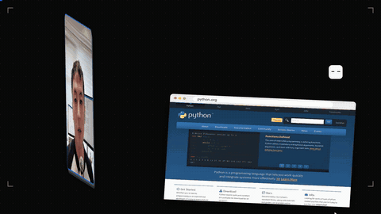
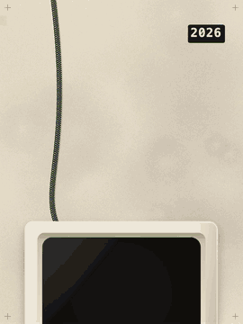
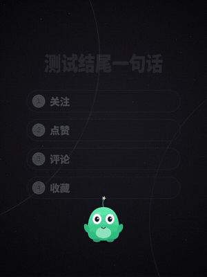

# OpenSay

OpenSay 是一个口播视频模板库：把一段真人口播的音频或视频交给你的 agent，它会照着模板规范逐镜编排画面，渲染出成片。即使是能力一般的模型，按规范也能做出成片。

## 云端曲库 `bgm/`

`bgm/index.json` 列出了每首曲目的时长、大小、sha256 和下载地址。做片时，agent 会按文案情绪和片长挑选曲目，只下载用到的那一首，并用 sha256 核对文件。用户自己提供的音乐优先使用。

## 模板包 `template/`

| 模板 | 文件 | 说明 |
|---|---|---|
| 开放表达 | [`template/开放表达.opensay`](template/开放表达.opensay) | 横屏 16:9；42 个模块；纸卡、小人物和红章；大部分模块都能带真人出镜，也能只用口播音频做不出镜的片子 |
| 印刷海报 | [`template/印刷海报.opensay`](template/印刷海报.opensay) | 竖屏 3:4；27 个模块；复古印刷海报风，胶带标签、红章、手写橙字、抖动描边和涂鸦角色；3 个真人出镜模块 |
| 科技面板 | [`template/科技面板.opensay`](template/科技面板.opensay) | 竖屏 3:4；23 个模块；深色科技面板风，薄荷绿数据、玻璃面板和两个自绘角色；3 个真人出镜模块 |

每个模板都覆盖了常见的口播分镜：开场提问、类比解释、对错清单、因果、数据、时间线、引用原话、展示照片和录屏、价格优惠、结尾号召。某一镜确实没有合适的模块时，agent 会用最接近的模块顶替并照常出片，同时在项目目录里留下 `module-gaps.json`（不含口播原文）。你愿意的话可以把它发给模板作者，帮助补全模块。

### 怎么用

1. 下载 `.opensay` 文件，不用解压。
2. 把它和你的口播视频（或口播音频）一起交给你的 agent（Claude Code、Codex、WorkBuddy 等能执行命令的都行），说一句"用这个模板把我的口播做成视频"。
3. agent 会按文件开头的说明自己解包、检查环境（缺什么会先问你要不要装）、逐镜编排并渲染出片。

需要的环境：Python 3.10+、Node.js 22+、ffmpeg、whisper.cpp（`whisper-cli` 加 `ggml-large-v3-turbo` 模型）。第一次渲染时会自动下载浏览器内核。

### 开放表达 · 部分模块预览

| | | |
|---|---|---|
|  问题卡 |  因果链 |  柱状对比 |
|  真人换位 |  物件卡加 logo |  浏览器演示 |

### 印刷海报 · 部分模块预览

| | | |
|---|---|---|
|  复古显示器 |  涂鸦角色阵 |  对错清单 |

### 科技面板 · 部分模块预览

| | | |
|---|---|---|
|  AB 对照 |  数据图表 |  结尾号召 |

预览里的文字和素材都是测试内容。

## skills/

给 agent 用的技能（复制到你的 agent 技能目录即可，例如 Claude Code 的 `~/.claude/skills/`、Codex 的 `~/.codex/skills/`）：

| 技能 | 用途 |
|---|---|
| [`opensay-template-builder`](skills/opensay-template-builder/) | 从一条参考视频新建 OpenSay 模板，或给已有模板补同风格的模块；包含开发规范、准入检查与测试脚本 |
| [`sticker`](skills/sticker/) | 用一条真人口播音频或视频，按 OpenSay 模板做出成片：对齐、分镜、渲染、配乐、审核。不写文案 |
| [`short-release`](skills/short-release/) | 把确认好的成片做成发布包；标题、简介、标签由用户在对话里直接给出，原样使用。含 X 草稿投递契约 |
| [`video-publisher`](skills/video-publisher/) | 把发布包存进小红书、抖音、B站、视频号草稿箱并重开核对；YouTube 走官方 API 私密上传。不公开发布 |
